  

  <picture>
    <source media="(prefers-color-scheme: dark)" srcset="https://readme-typing-svg.demolab.com?font=Fira+Code&weight=600&size=20&pause=1200&color=BD93F9&background=00000000&center=true&vCenter=true&width=640&lines=Ol%C3%A1!+Eu+sou+o+Saulo+Silva+%F0%9F%91%8B;Full+Stack+Developer+%E2%80%A2+React%2C+Vite+%26+Node.js;Mobile+Developer+%E2%80%A2+Flutter+%26+Firebase;Data+Analyst+%26+BI+%E2%80%A2+SQL%2C+Python+%26+Power+BI;Bras%C3%ADlia%2C+DF+%E2%80%A2+Ci%C3%AAncia+da+Computa%C3%A7%C3%A3o+(UDF)" />
    
  </picture>

  
  
  
  

## 👨‍💻 Sobre Mim

Sou bacharel em **Ciência da Computação pelo UDF** e pós-graduando em **Ciência de Dados e Big Data Analytics**, com perfil híbrido que une **Desenvolvimento Full Stack & Mobile** à **Análise de Dados & Business Intelligence**.

Com experiência prática na **BB Administradora de Consórcios S.A. (Banco do Brasil)** e no **UDF**, atuo transformando dados operacionais e financeiros em indicadores estratégicos com **SQL, Python, Power BI e Excel/VBA**. No desenvolvimento de software, construo aplicações web e mobile ponta a ponta utilizando **React, Vite, Node.js, Flutter e Firebase**, sempre com foco em performance, usabilidade e código limpo.

- 🎓 **Formação:** Bacharel em Ciência da Computação (UDF) • Pós-graduando em Ciência de Dados & Big Data Analytics
- 💻 **Full Stack & Mobile:** Aplicações web e mobile com React, Vite, Node.js, APIs RESTful, Flutter e Firebase
- 📊 **Dados & BI:** Dashboards, análises e automações com SQL, Python, Power BI, Streamlit e Excel/VBA
- 🎪 **Comunidade Tech:** Líder de Comunidade e Caravana na **Campus Party** • Staff no IGXP/InovaShow
- 📍 **Localização:** Brasília, DF — Brasil

## 🛠️ Stack Tecnológica

#### Front-end & Mobile

#### Back-end & Banco de Dados

#### Dados, BI & Ferramentas

## 🚀 Projetos em Destaque

| Projeto | Links | Tecnologias | Descrição |
| :--- | :---: | :---: | :--- |
| **Pobreokê** | [Código](https://github.com/eusaulosilva/pobreoke) · [Site](https://pobreoke.com.br/) | `React` `Vite` `Firebase` `PWA` | Plataforma de gestão de filas de karaokê em tempo real desenvolvida para eventos como a **Campus Party 2026**, com painel de DJ, sincronização com tela de TV, QR Code e busca integrada no YouTube. |
| **Portfólio Pessoal** | [Código](https://github.com/eusaulosilva/portifolio-react_vite) · [Site](https://eusaulosilva.com.br/) | `React` `Vite` `Node.js` `CI/CD` | Site profissional (*dark glassmorphism*) com SEO/Open Graph, API própria em Node.js para contato, deploy automatizado via GitHub Actions e gerador dinâmico de currículo em PDF. |
| **ManScan (TCC)** | [Código](https://github.com/eusaulosilva/manscanapp) | `Flutter` `Dart` `Firebase` `Cloudinary` | Aplicativo mobile de monitoramento da saúde masculina desenvolvido como TCC no UDF, com acompanhamento de pressão arterial, IMC, passos e gestão de exames na nuvem. |
| **Job Finder** | [Código](https://github.com/eusaulosilva/job-finder) · [Demo](https://job-finder-two-delta.vercel.app/) | `Node.js` `Express` `SQLite` `Handlebars` | Portal web full stack para busca, cadastro e visualização de vagas de trabalho voltadas a desenvolvedores. |
| **Dashboard de Salários** | [Código](https://github.com/eusaulosilva/imersao-dados-python-alura) | `Python` `Streamlit` `Pandas` | Painel interativo de ciência de dados para análise de mercado e evolução salarial na área de dados. |

## 📊 Métricas & Atividade no GitHub

  
  

  

  

## 👾 Gráfico de Contribuições

  <picture>
    <source media="(prefers-color-scheme: dark)" srcset="https://raw.githubusercontent.com/eusaulosilva/eusaulosilva/output-pacman/pacman-contribution-graph-dark.svg" />
    <source media="(prefers-color-scheme: light)" srcset="https://raw.githubusercontent.com/eusaulosilva/eusaulosilva/output-pacman/pacman-contribution-graph.svg" />
    
  </picture>

## 📫 Vamos Conversar?

  
Aberto a oportunidades em <strong>Desenvolvimento Full Stack</strong>, <strong>Mobile</strong> e <strong>Análise de Dados / BI</strong>, além de parcerias em projetos e eventos da comunidade tech.

  
  &nbsp;
  
  &nbsp;
  

  

